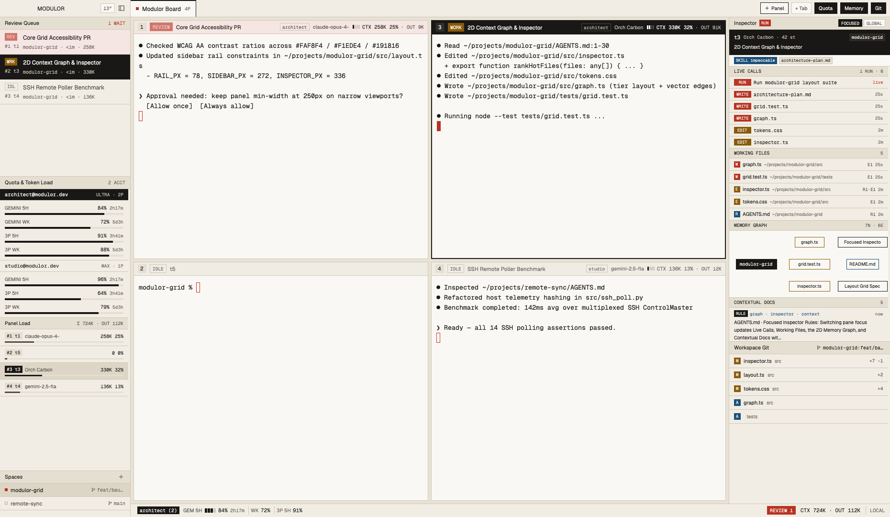
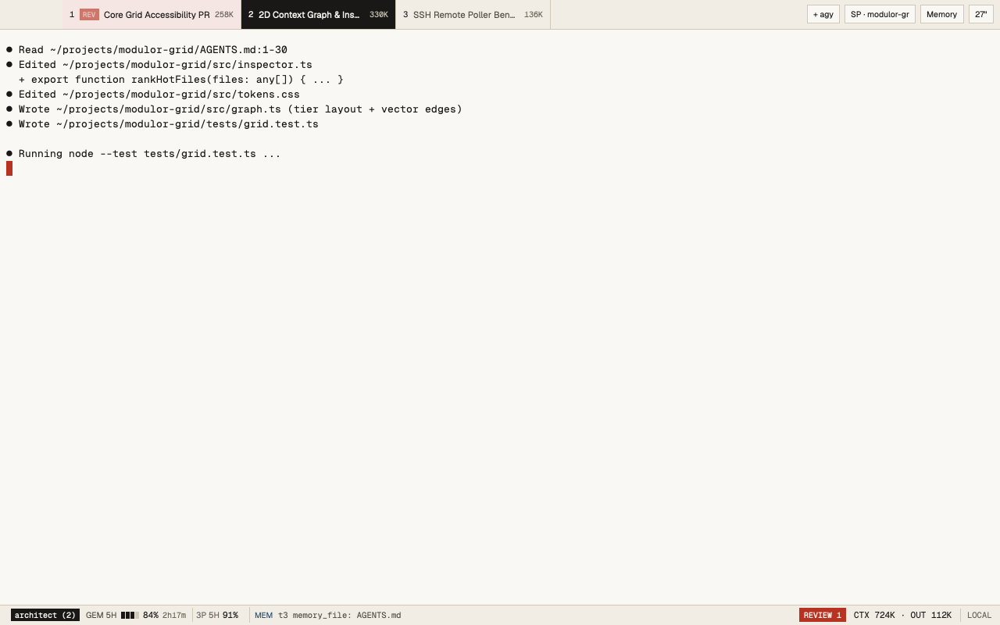

# Modulor — Bauhaus & Le Corbusier Command Wall for Herdr

A functionalist **light-only** workspace layout and 7-mod telemetry suite for [Herdr App](https://herdr.dev), inspired by *Le Modulor* grids and Le Corbusier's *Polychromie Architecturale*.

Designed to inspect 3–6+ coding agents simultaneously on a 27" monitor (`modulor-27`) without hiding behind popups or zoom modes, with a companion single-strip focus view for a 13" MacBook Air (`modulor-13`).



## Highlights

- **Light Bauhaus Grid (`corbusier-light`)**: Zero border radius, `1px` `#CFC8B8` architectural dividers, warm mineral paper tones (`#FAF8F4` / `#F1EDE4` / `#E8E2D5`), inverted `#191816` carbon focus framing, and high-contrast functional accents (`#B83221` Vermilion review/running, `#1B4F79` Ultramarine unread/read, `#8A5A0A` Ochre working/edit).
- **27" All-Panels Wall (`modulor-27`)**:
  - **Left Column (`272px`)**: Priority `Review Queue` (`REV` > `NEW` > `WRK` > `IDL`, synced with `Cmd+]`), persistent `Quota & Token Load` (multi-account rate-limit meters + side-by-side `Panel Load`), and local/SSH `Spaces`. Collapsible to a minimal numbered rail.
  - **Center Multi-Pane Grid**: Direct `+ Panel` splits onto the active board, `TILE ALL` recovery when agents sit on background tabs, `SHOW ALL PANELS` unzoom guard, and independent `Quota` / `Memory` / `Git` toggles (`Cmd+Shift+M`).
  - **Right Real-Time Inspector (`336px`)**: Automatically follows the **currently focused panel** (`FOCUSED` default + `GLOBAL` toggle) — streaming `LIVE CALLS` (with pulsing `RUN`), `WORKING FILES` (`R`/`E` counts), a 2D vector `MEMORY GRAPH`, `CONTEXTUAL DOCS` / `CONTEXTUAL MEMORY`, plus smart `Workspace Git` (`TRACK` follows the repository of files the focused agent actually reads/edits).
- **13" Focus View (`modulor-13`, `Cmd+Shift+9`)**: Full-bleed active agent viewport with a scrollable top status strip and popup triggers for Spaces & Inspector.



## Quick Install

In Herdr, ask your agent:

```text
Install herdr.dev/layouts/adm-humanerd/herdr-modulor
```

Or install manually by reading [`RECIPE.md`](RECIPE.md) or copying `layouts/`, `themes/corbusier-light.json`, `mods/modulor-*`, and merging `keys.json` into `~/.config/herdr-app/`.

Recommend setting `"theme": "corbusier-light"` and `"appearance": "light"` in `~/.config/herdr-app/settings.json`.

## Keyboard Shortcuts (`keys.json`)

| Shortcut | Action |
| --- | --- |
| `Cmd+Shift+0` | Switch to 27" All-Panels Command Wall (`modulor-27`) |
| `Cmd+Shift+9` | Switch to 13" Focus View (`modulor-13`) |
| `Cmd+Shift+M` | Toggle the right-hand Inspector column (`panel`) |
| `Cmd+]` / `agent.next` | Cycle agents in `Review Queue` priority order |

## Optional Telemetry & Extensions

1. **Zero-config Workspace Docs (`CONTEXTUAL DOCS`)**: Out of the box, `probe.py` indexes `AGENTS.md`, `CLAUDE.md`, `MEMORY.md`, `.cursorrules`, `RECIPE.md`, and `README.md` inside each focused project repo to populate `CONTEXTUAL DOCS` and the 2D `MEMORY GRAPH`.
2. **External SQLite Memory DB (`MODULOR_MEMORY_DB`)**: Export `MODULOR_MEMORY_DB=/path/to/memory.db` (compatible with `slots`, `memories`, `nodes`, `edges` schema) to switch the inspector to live SQLite recall + ontology graph traversal (always opened read-only `?mode=ro`).
3. **Antigravity (`agy`) Multi-Account Quotas**: Add to `~/.gemini/antigravity-cli/settings.json` to feed exact per-account `5h` / `weekly` quota bars and `effort` telemetry into `~/.cache/herdr-modulor/`:
   ```json
   {
     "statusLine": {
       "type": "command",
       "command": "~/.config/herdr-app/mods/modulor-bar/agy-statusline.sh",
       "enabled": true,
       "stack_with_default": true
     }
   }
   ```
4. **Other Coding Agents (`claude`, `codex`, `opencode`, `pi`)**: Panes, Review Queue, Spaces, `+ Panel` auto-detection, and `Workspace Git` work natively via Herdr APIs for all agents; see `RECIPE.md` for extending `probe.py` with transcript parsers for additional CLIs.

## License

MIT — see [`LICENSE`](LICENSE).
