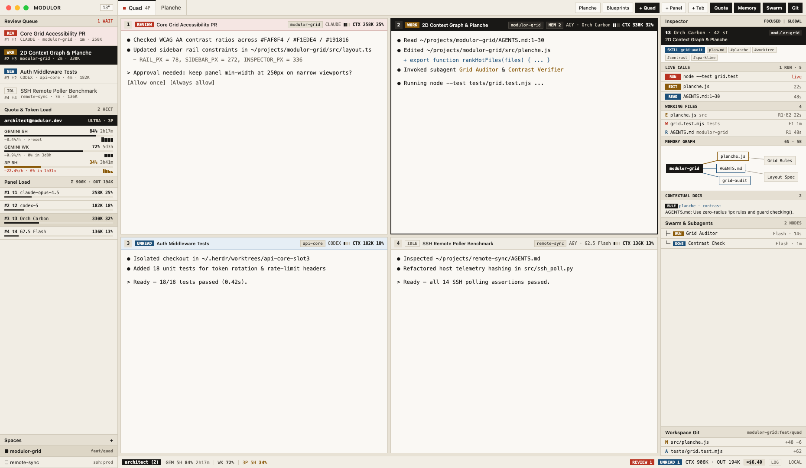

# Modulor

A warm Bauhaus and Le Corbusier (*Le Modulor* & *Polychromie Architecturale*) light workspace for running three to six coding agents side by side without losing track of what is happening or where an edit might collide. Most of the screen stays quiet monochrome paper and limestone gray so Vermilion (`#B83221`), Ultramarine (`#1B4F79`), and Ochre (`#8A5A0A`) jump out immediately when an agent needs input, finishes a turn, writes over another agent's file, or risks burning through a quota window before reset. Includes a 27-inch command wall, a collapsible numbered rail, a 13-inch laptop focus strip, multi-agent `2×2` board templates with automatic git worktrees, and a dedicated command desk for inspecting walls, plans, screenshots, dev ports, logs, and 7-day token cost.

This file is the brief: enough to build Modulor from an empty folder. The files next to it are one build of it. If they don't work on your Herdr, or you want it different, build it again from here.

## What you see

Built on a zero-radius (`radius: 0`), `1px` architectural grid (`#CFC8B8` dividers) using crisp mineral light surfaces from `themes/corbusier-light.json`:

| Surface / Accent | Hex | Role |
| --- | --- | --- |
| `background` / `surface` / `popover` | `#FAF8F4` | Active pane canvas, card interiors, node chips |
| `chrome` | `#F1EDE4` | Left sidebar, right inspector, strip, status bar |
| `canvas` | `#E8E2D5` | Tiled grid gutter behind panes |
| `raised` / `selected` | `#E5DFD2` / `#DDD6C6` | Section headers, focused panel-load rows |
| `border` / `input` | `#CFC8B8` / `#B2AA99` | Grid rules and outer popup frames |
| `foreground` / `muted` / `dim` | `#191816` / `#4F4B44` / `#6B655B` | Carbon black text and inverted focused rows/headers |
| `blocked` (Vermilion) | `#B83221` | Needs attention (`REV`, `REVIEW`), `RUN`, `CONFLICT`, `LESSON`, urgent quota warning |
| `done` (Ultramarine) | `#1B4F79` | Unread finished (`NEW`, `UNREAD`), `READ`, `DOC` |
| `working` (Ochre) | `#8A5A0A` | Active turn (`WRK`, `WORK`), `EDIT`, `GRAPH` |

### `modulor-27` (27-inch Multi-Agent Command Wall)

- Root horizontal row with no native titlebar (`traffic_lights: [14, 11]`), `Geist Mono` (`13.5px`, `1.14` line height, `10×12` terminal padding) and `Geist` UI typography.
- **Left sidebar (`272px`, resizable `68..440`, `chrome`)**:
  1. **Review Queue** (top `weight: 3`, min `150`): `36px` `MODULOR` header with `13"` layout switcher and collapse button, `26px` `Review Queue` sub-header, and priority-sorted agent rows showing `[project]` repo chip, harness tag (`AGY`, `CLAUDE`, `CODEX`, etc.), model/elapsed time, and `!CNF` write-collision badge. Collapses cleanly into a `78px` macOS (`54px` Linux) numbered status rail.
  2. **Quota & Token Load** (middle `weight: 5`, min `210`): `26px` header with account count, scrollable multi-account cards (`GEMINI 5H`, `GEMINI WK`, `3P 5H`, `3P WK`) showing remaining `%`, reset countdown, remaining bar, rolling burn-rate forecast (`collecting trend…`, `stable · 0%/h`, `-X.X%/h · 0% in <time>`, or `>reset`), and a 16-bar reset-cycle sparkline on the right, followed by per-pane `Panel Load` context bars.
  3. **Spaces** (bottom `96px`, min `72`): `Spaces` header (`Spaces · N SSH` when connected remotely) with `+` new space trigger and scrollable workspace rows showing git branch and machine badge.
- **Center work area**:
  1. **Top tab & command strip (`36px`, draggable)**: Board tabs with `2px` `#191816` top rule on active, automatic recovery pills when needed (`SHOW ALL PANELS` if zoomed, `TILE ALL (N)` if floating, `Compose <Board>` on a single empty shell tab), quick board launchers (`Planche`, `Blueprints`, `+ <DefaultBoard>` e.g. `+ Quad`, `+ Panel`, `+ Tab`), and independent right-deck toggles (`Quota`, `Memory`, `Swarm`, `Git`).
  2. **Agent grid & right inspector**:
     - Center tiled panes (`6px` `canvas` gutter, `1px` border, `2px` `#191816` focus frame even on lone panes) each capped with an always-visible `28px` header displaying `#index`, status/mod pill, pulsing `CONFLICT` badge when two agents collide, title, `[project]` folder chip, `MEM n` activity pill, harness/model label, context mini-meter + token readout, and hover split/close buttons.
     - **Right Inspector (`336px`, resizable `250..540`, toggle `Cmd+Shift+M`)**: **Inspector** (`weight: 6`, min `210` — `FOCUSED`/`GLOBAL`, active skills, clickable artifacts & working files, `#keywords`, `LIVE CALLS`, interactive 2D `MEMORY GRAPH`, `CONTEXTUAL DOCS`/`MEMORY`, collapsible `WORKING SLOTS`), **Swarm & Subagents** (`weight: 2`, min `108` — subagent & child terminal tree), and **Workspace Git** (`weight: 3`, min `140` — active repo diff & status).
  3. **Bottom telemetry bar (`28px`)**: Active account pill, 4-cell quota meters, `MEM` popup pill when right panel is closed, `REVIEW N` / `UNREAD N` buttons, `CTX · OUT` sum, `≈$X.XX` 7-day API-equivalent cost ledger trigger, `LOG` log watcher toggle, and `LOCAL`/`SSH` badge.

### `modulor-13` (13-inch Laptop / SSH Focus View)

- Root vertical stack (`13px` terminal text, `1.12` line height, `8×10` padding).
- **Top strip (`38px`)**: Traffic-light inset + horizontal agent chips + `+ <Agent>`, `Planche`, `Blueprints`, `SP` spaces popup, `Memory` popup, and `27"` layout switcher.
- **Viewport**: Full-bleed focused terminal.
- **Bottom bar (`26px`)**: Compact status bar with left `QUEUE` (`320×460` centered dialog), quota cells, `MEM` pill, `≈$X.XX`, and `LOG`.

## How it behaves

- **Status representation**: `blocked` uses Vermilion `#B83221` (`REV`/`REVIEW`, subtle opacity pulse `0.62 -> 1` when unfocused, `#F5E6E3` tint), `done` uses Ultramarine `#1B4F79` (`NEW`/`UNREAD`, `#E6EEF5` tint), `working` uses Ochre `#8A5A0A` (`WRK`/`WORK`), `idle` uses `1px` bordered `IDL`/`IDLE`. Focused rows and focused pane headers invert cleanly to `#191816` background with `#FAF8F4` text.
- **Sorting & focus cycling**: `Review Queue` sorts `blocked (4) > done (3) > working (2) > idle (1)` and publishes `setAgentOrder(...)` so built-in cycling matches visual order; `Cmd+Alt+R` (`modulor-bar.next-review`) jumps directly between blocked/done panes.
- **Quota burn forecast, hover explanations & sparklines**: Each snapshot is logged (7-day retention, reset cycle isolated by `reset_time` changes or `+10%` refills). Once at least 2 samples `≥ 60s` apart exist in the current cycle, OLS linear regression over the last `90m` (`5H` buckets) or `24h` (`WK` weekly buckets) produces `collecting trend…`, `stable · 0%/h` (`< 0.05%/h`), `-X.X%/h · >reset` (`outlasts reset` in the popup), or `-X.X%/h · 0% in <time>` (turned Vermilion `#B83221` on `5H` whenever projected to hit `0%` before reset, and on `WK` when `≤ 36h`). Every bucket displays up to 16 chronological remaining-`%` bars on the right and a live `.tooltip(...)` explaining its exact regression window, exhaustion time vs reset time, and sparkline behavior on hover.
- **Multi-agent Blueprints & worktree isolation**: Presets (`Quad 2×2 · 4 Agents` ★ default, `Quad 3+1`, `Triptych 1·1·1`, `Unité 58:42`, `Hex Wall 3×2`, plus user-saved boards) let users assign per-slot harnesses (`claude`, `codex`, `agy`, `gemini`, `opencode`, `pi`, `shell`, or panel mods), auto-deal local git repos (`Deal 1..N`), and enable per-slot git worktrees (`~/.herdr/worktrees/<repo>-slotN`). Closing the dialog never cancels a spawn because split sequencing runs asynchronously inside `modulor-bar`.
- **Planche Command Desk**: Three-tab board (`WALL`, `DOCS`, `PORTS`) showing live agent cards + conflict warnings, markdown/PNG doc inspection with one-click `- [ ]` task `[Spawn ↗]`, and active local TCP listeners (`1024–65535`).
- **Write-collision detection, alerts & click-to-open**: Two agents touching the same file or sharing a non-worktree checkout flag `CONFLICT` / `!CNF`. Non-duplicating operational alerts fire on quota `≤35%`/`≤15%` crossings, window refills, context `≥80%`/`≥90%`, and stale probes (`>60s`), while OS window titles summarize status/quotas/space. Clicking local artifacts/working files opens them (`Cmd+Click` reveals in Finder); remote paths copy to clipboard. Clicking `≈$X.XX` (`Cmd+Alt+C`) opens the 7-day incremental cost ledger; clicking `LOG` (`Cmd+Alt+L`) toggles the persistent folder log watcher window.

## Built from

- **Layouts**: `layouts/modulor-27.json` (+ `layouts/modulor-27.svg`) and `layouts/modulor-13.json` (+ `layouts/modulor-13.svg`).
- **Theme**: `themes/corbusier-light.json`.
- **Keys (`keys.json`)**: `cmd-shift-0` (`layout.switch:modulor-27`), `cmd-shift-9` (`layout.switch:modulor-13`), `cmd-shift-m` (`layout.toggle:panel`), and dot-syntax mod bindings under `global`: `cmd-alt-b` (`modulor-bar.blueprints`), `cmd-alt-n` (`modulor-bar.new-board`), `cmd-alt-p` (`modulor-bar.planche`), `cmd-alt-r` (`modulor-bar.next-review`), `cmd-alt-q` (`modulor-bar.quota`), `cmd-alt-a` (`modulor-bar.queue`), `cmd-alt-e` (`modulor-bar.memory`), `cmd-alt-c` (`modulor-bar.cost`), `cmd-alt-l` (`modulor-bar.logs`).
- **Mods (all 12 `mod.json` use `"place": "none"`):**
  - `modulor-bar` (`main.js` status bar + quota popup + `nextCommand` router, `alerts.js`, `spawner.js`, `probe.py`, `agy-statusline.sh`, `icons/*.svg`)
  - `modulor-pane`, `modulor-queue`, `modulor-quota`, `modulor-strip`, `modulor-memory`, `modulor-git`, `modulor-swarm`, `modulor-cost`, `modulor-log`, `modulor-blueprint`, `modulor-planche`.
- **Telemetry contract & cache (`probe.py`)**: Emits `{ ts, latest_email, active_emails, accounts, terminals, conflicts, memory, usage }`. Indexes repo markdown docs (`AGENTS.md`, `CLAUDE.md`, `MEMORY.md`, `.cursorrules`, `RECIPE.md`, `README.md`) zero-config or switches to read-only SQLite when `MODULOR_MEMORY_DB` is set; reads `agy` sessions when present; persists `~/.cache/herdr-modulor/{quota-history.jsonl,usage-ledger.json,prices.json}`.

## Watch out

- **Light-mode pairing**: Always pair `"theme": "corbusier-light"` with `"appearance": "light"` in `settings.json` (`minimum_contrast: 4.2` recommended).
- **Dot vs colon in `keys.json`**: Mod actions MUST use dot syntax (`"modulor-bar.blueprints"`), never colons.
- **`window.paint_path` scope**: `paint_path(path, color)` lives on ambient global `window` (`globalThis.window.paint_path`), never on `cx.window` (`cx.window` is `undefined`). Always call `.size_full()` on the element returned by `paint_path`.
- **`.tooltip(...)` requires `.id(...)` in GPUI**: Any `div()` / `h_flex()` / `v_flex()` attaching `.tooltip(...)` must first call `.id(...)`, otherwise `herdr-app check` rejects it.
- **`.when()` callback convention**: `.when(cond, (el) => el.child(...))` passes the parent container; returning a child directly without `el.child(...)` replaces the parent element.
- **`image()` root path**: `image(path)` resolves relative to `appHome()` (`~/.config/herdr-app`), so external `.png`/`.jpg` artifacts are staged into `.planche-thumbs/`.
- **Checking guard & git safety**: Guard timers, `exec`, `notify`, `setBadge`, `setWindowTitle`, and `nextCommand` with `if (checking()) return;`; never run `--untracked-files=normal` when `root === home()`.

## Done when

- `for m in modulor-bar modulor-pane modulor-queue modulor-quota modulor-strip modulor-memory modulor-git modulor-swarm modulor-cost modulor-log modulor-blueprint modulor-planche; do herdr-app check ~/.config/herdr-app/mods/$m || exit 1; done` exits `0`.
- `python3 -m json.tool` passes on every `.json` file under `layouts/`, `themes/`, `keys.json`, and `mods/*/`.
- `python3 mods/modulor-bar/probe.py | python3 -m json.tool` prints valid telemetry JSON (`ts`, `accounts`, `terminals`, `conflicts`, `memory`, `usage`) in `< 1s` with zero PII.
- `herdr-app status` reports `"errors": []` with both `modulor-27` and `modulor-13` working cleanly.
